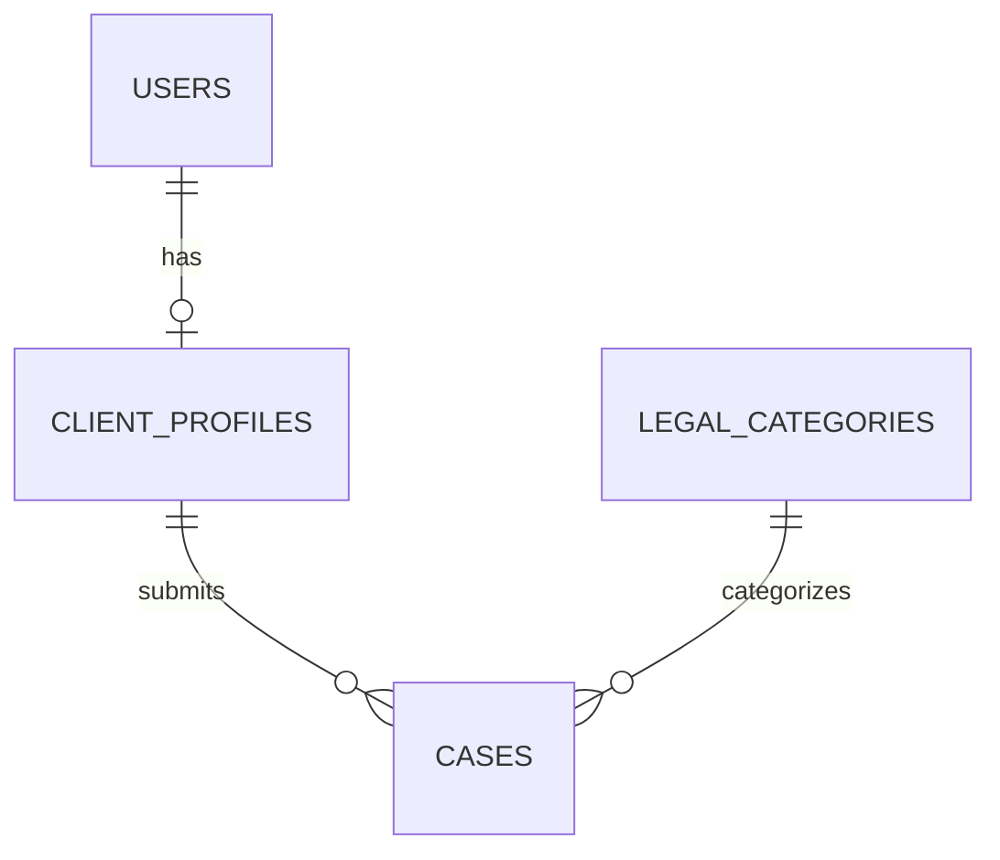

## Goal

To make client legal dashboard

## User

Client posting a legal case

## MVP Scope

Build a client-only legal case management dashboard.

In Scope:

- Client registration, login, logout
- Client profile management
- Dashboard showing case statistics
- Browse legal categories
- Create and save draft cases
- Edit draft cases
- Submit cases
- View and filter submitted cases
- View case details
- Close cases

Out of Scope:

- Lawyer accounts and dashboards
- Lawyer matching
- Messaging
- Payments
- Notifications
- Document uploads
- Admin dashboard

The MVP ends when a client successfully submits
and manages their own legal cases.

## Business Rules

- Only registered clients can create cases.
- Each case belongs to exactly one client.
- Clients can only access their own cases.
- New cases start with DRAFT status.
- Draft cases can be edited or deleted.
- Cases require title, category, description,
  and location before submission.
- Submitted cases cannot be edited.
- Submitted cases can be closed.
- Closed cases cannot be reopened in the MVP.
- Deleted cases are soft-deleted.
- Inactive legal categories cannot be selected
  when creating or updating a case.
- Lawyer matching is not implemented in the MVP.

## Features

- Registration / Login
- Client Dashboard
- Submit Case
- My Cases
- Case Details
- Edit / Close Case
- Profile & Settings

## Pages

- login / register
- dashboard
- my cases
- case details
- create case
- profile & settings

## Routes

- `/login` - Login
- `/register` - Register
- `/forgot-password` - Forgot Password
- `/reset-password` - Reset Password
- `/verify-email` - Verify Email
- `/dashboard` - Dashboard
- `/cases` - My Cases
- `/cases/new` - Create Case
- `/cases/:id` - Case Details
- `/cases/:id/edit` - Edit Draft
- `/profile` - Profile
- `/settings` - Settings

Routing Rules:

- `/` → Redirect to `/dashboard` if authenticated, otherwise `/login`.
- Public auth pages → Redirect authenticated users to `/dashboard` where appropriate.
- Protected routes → Redirect unauthenticated users to `/login`, preserving the intended destination.
- `/cases/new` and `/cases/:id/edit` → Use the same reusable case form component.
- `/cases/:id/edit` → Allow editing drafts only.
- `*` → Display a 404 Not Found page.
- After registration → Redirect to `/cases/new` once authentication and any required email verification are complete.

## Flow

register -> submit a case

## UI/UX

Design:

- Modern, professional legal-service dashboard
- Ant Design component library
- Responsive desktop and mobile layouts
- Consistent typography, colors, and spacing
- Accessible forms and navigation

Public Layout:

- Login
- Registration
- Forgot Password
- Reset Password

Authenticated Layout:

- Sidebar navigation
- Top header with profile menu
- Main content area

Pages:

- Dashboard: statistics and recent cases
- My Cases: searchable, filterable, paginated table
- Case Details: case information and available actions
- Create Case: draft case form (submitted from Case Details)
- Profile & Settings: personal and security settings

UI States:

- Loading indicators
- Empty states
- Validation errors
- API errors
- Success notifications
- Confirmation dialogs for destructive actions
- Responsive mobile navigation

## Authentication

- Spring Security session-based authentication
- Server-side sessions persisted using Spring Session JDBC
- Secure, HttpOnly, SameSite cookies
- CSRF protection for state-changing requests
- BCrypt password hashing
- Session restoration using GET /auth/me
- Session invalidation on logout
- Protected frontend routes
- Server-side authorization on every protected API
- Client can access only their own resources
- Rate limiting on authentication endpoints
- Generic login errors to prevent account enumeration
- Email verification and password reset
- Single origin for SPA and API via CloudFront

## Data Model

### Schema

database: PostgreSQL

tables:
users:
id: uuid, PK
email: varchar(254), unique, not null, case-insensitive
password_hash: varchar(255), not null
role: enum(CLIENT, LAWYER, ADMIN), default CLIENT
status: enum(ACTIVE, SUSPENDED, DISABLED), default ACTIVE
email_verified: boolean, default false
created_at: timestamptz
updated_at: timestamptz
deleted_at: timestamptz, nullable

client_profiles:
id: uuid, PK
user_id: uuid, FK(users.id), unique, not null
first_name: varchar(100), not null
last_name: varchar(100), not null
phone: varchar(30), nullable
created_at: timestamptz
updated_at: timestamptz

legal_categories:
id: uuid, PK
name: varchar(100), unique, not null
description: text, nullable
is_active: boolean, default true
created_at: timestamptz
updated_at: timestamptz

cases:
id: uuid, PK
client_id: uuid, FK(client_profiles.id), not null
category_id: uuid, FK(legal_categories.id), not null
title: varchar(200), not null
description: text, nullable
location: varchar(255), nullable
status: enum(DRAFT, SUBMITTED, CLOSED)
created_at: timestamptz
updated_at: timestamptz
submitted_at: timestamptz, nullable
closed_at: timestamptz, nullable
deleted_at: timestamptz, nullable

### ER Diagram



## API Design

### 1. Authentication

POST /auth/register - Register a client
POST /auth/login - Login and create session
POST /auth/logout - Invalidate session
GET /auth/me - Get current authenticated user
POST /auth/forgot-password - Request password reset
POST /auth/reset-password - Reset password
POST /auth/verify-email - Verify email address

### 2. Client Profile

GET /clients/me - Get client profile
PATCH /clients/me - Update client profile
PATCH /clients/me/password - Change password

### 3. Legal Categories

GET /legal-categories - List active legal categories

### 4. Case Management

POST /cases - Create a draft case
GET /cases - List my cases with filtering, sorting, pagination
GET /cases/{id} - Get case details
PATCH /cases/{id} - Update a draft case
POST /cases/{id}/submit - Submit a draft case
POST /cases/{id}/close - Close a case
DELETE /cases/{id} - Soft-delete an eligible case

### 5. Dashboard

GET /dashboard/summary - Get case counts, statuses, and recent cases

### 6. Infrastructure

GET /actuator/health - Application health check
GET /actuator/health/readiness - ECS/ALB readiness check

### API Error Response

RFC 9457 Problem Details

```json
{
  "type": "https://api.example.com/problems/validation-error",
  "title": "Validation Failed",
  "status": 400,
  "detail": "One or more fields contain invalid values.",
  "instance": "/api/v1/auth/register",
  "errorCode": "VALIDATION_ERROR",
  "timestamp": "2026-10-14T07:30:00Z",
  "traceId": "a1b2c3d4",
  "fieldErrors": [
    {
      "field": "email",
      "message": "Invalid email address"
    },
    {
      "field": "password",
      "message": "Password must contain at least 12 characters"
    }
  ]
}
```

Use HTTP response header:

```
Content-Type: application/problem+json
```

Standard Fields:

- type - Identifies the error type
- title - Human-readable error category
- status - HTTP status code
- detail - Explanation safe to display to users
- instance - Request path
- errorCode - Stable application error identifier
- timestamp - Time of error
- traceId - Correlates errors with backend logs
- fieldErrors - Optional field-level validation errors

The last four fields are custom extensions to RFC 9457.

Common API errors:

- 400 - VALIDATION_ERROR - Invalid form inputs
- 401 - UNAUTHORIZED - Missing or expired session
- 403 - FORBIDDEN - Insufficient permissions
- 404 - CASE_NOT_FOUND - Case doesn't exist or isn't accessible
- 409 - EMAIL_ALREADY_EXISTS - Registration conflict
- 409 - INVALID_CASE_STATE - Submitting an already-closed case
- 429 - RATE_LIMIT_EXCEEDED - Too many requests
- 500 - INTERNAL_ERROR - Unexpected server failure
- 503 - SERVICE_UNAVAILABLE - Temporary service outage

### API Conventions

- Authentication: Secure, HttpOnly session cookie with CSRF protection for state-changing requests.
- Authorization: Validate ownership of every case server-side.
- Responses: JSON DTOs; never expose entities or password hashes.
- Errors: Use RFC 9457 Problem Details.
- Pagination: Use Spring Data Pageable, with server-enforced maximum page size.
- Validation: Jakarta Bean Validation (@Valid).
- Versioning: /api/v1.
- Security: Rate-limit authentication endpoints and keep operational endpoints appropriately restricted.

## Testing

Frontend:

- Vitest + React Testing Library
- Test forms, validation, and component behavior
- Mock API responses using MSW

Backend:

- JUnit 5 + Mockito
- Spring Boot integration tests
- Testcontainers with PostgreSQL
- Test authentication, authorization, and business rules

E2E:

- Playwright
- Registration and login
- Create draft and submit case
- View and edit own draft case
- Logout and protected-route redirects

Security:

- Verify users cannot access other clients' cases
- Verify CSRF protection
- Test invalid sessions and expired sessions
- Test validation and error responses

CI:

- Run automated checks on every push to main.
- Deploy to AWS only when all CI checks pass.
- Skip deployment if any check fails.

## Observability

Keep it simple. No need for Datadog, Grafana, or a complex distributed tracing platform yet.

- Spring Boot Actuator
- Micrometer metrics
- Structured JSON application logs
- AWS CloudWatch Logs and Metrics
- Correlation/trace ID in logs and API errors
- HTTP request count, latency, and error rates
- ECS CPU and memory monitoring
- ALB target health and 5xx monitoring
- RDS CPU, connections, and storage monitoring
- CloudWatch alarms for critical failures
- Never log passwords, sessions, or sensitive case data

## Environments

One deployed environment is fine, but you still need local development.

Local:

- React Vite development server
- Spring Boot
- PostgreSQL using Docker Compose

AWS:

- Single deployed environment
- ECS Fargate
- RDS PostgreSQL
- CloudFront + S3
- GitHub Actions deployment

Configuration:

- Environment variables
- AWS Secrets Manager
- Separate local and AWS configuration
- No secrets committed to Git

## Delivery Plan

1. Foundation
   - React + Vite + TypeScript
   - Spring Boot + PostgreSQL
   - Routing, layout, testing infrastructure
   - Basic CI pipeline

2. Authentication
   - Registration
   - Login/logout
   - Session management
   - Protected routes

3. Case Management
   - Legal categories
   - Create draft
   - My Cases, Case Details
   - Edit, delete, submit draft
   - Close case
   - Pagination, filtering, search

4. Client Dashboard
   - Case statistics
   - Recent cases

5. Profile & Settings
   - View/edit profile
   - Change password

6. Production Deployment
   - AWS infrastructure
   - CI/CD deployment
   - Monitoring and security verification

## Tech Stack

- React 19.3.0 (Latest)
- TypeScript
- Vite
- Java 21
- Spring Boot 4.1.1 (BFF)
- PostgreSQL
- Spring Security

## Infra

- Github Actions for CI/CD

One CloudFront distribution with two origins.

```
Route 53
  └── WAF + CloudFront
        ├── /*      → S3 (React)
        └── /api/*  → ALB → ECS Fargate → RDS
```

Configure:

- ACM – HTTPS certificates.
- CloudFront – Disable caching for authenticated API endpoints; forward necessary cookies, headers, and query strings.
- S3 – Private bucket with Origin Access Control.
- ALB – Health checks and routing to ECS tasks.
- ECS – Private subnets, task roles, auto scaling.
- RDS – Private subnets, automated backups.
- GitHub Actions – Build, test, push to ECR, deploy to ECS.
- Infrastructure as Code – Terraform or AWS CDK to provision infrastructure consistently.

### FE

- aws route 53
- aws waf
- aws cm
- aws cf
- aws s3
- aws iam
- aws cw

Setup: route 53 -> waf + cf -> s3

### BE

- aws route 53
- aws waf
- aws cm
- aws vpc (subnets, nat gateway, security groups)
- lb
- aws ecs with fargate
- aws ecr
- aws iam
- aws sm
- aws rds
- aws s3
- aws cw

Setup: route 53 -> waf + alb -> ecs fargate -> rds
